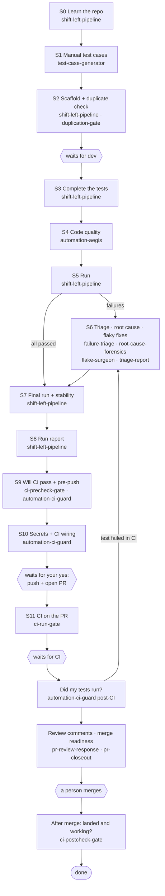

# How to Run the Shift-Left & CI Skills

_2026-10-20 · Belle_

The agent runs every step itself. You give it the ticket and the repo, review the reports and screenshots,
and say yes before anything other people can see (push, PR, comments, tickets).

---

## 1. Before you start

Do these three things once. Then every step runs by itself.

- [ ] **Skills saved.** The five updated cards: `ci-precheck-gate`, `ci-run-gate`, `ci-postcheck-gate`,
      `automation-ci-guard`, `shift-left-pipeline` (plus the chain skills you already have, like
      `automation-aegis` and `failure-triage`).
- [ ] **Repo folder linked** to the task in Cowork (for example `eng-guardrails-platform`). The first run in a
      repo installs the kit into its `.qa-kit/` folder, which git ignores. It is already installed in
      `eng-guardrails-platform`.
- [ ] **The facts only you know**, in your first message:

| Give the agent | Example | Needed for |
|---|---|---|
| Ticket key | FRAI-1234 | the whole chain (it names the run folder) |
| Repo | eng-guardrails-platform | every step |
| Base branch, if not the default | develop | pre-check, pre-push |
| Test environment | dev | running the tests, post-check |
| PR number | #16456 | CI run, post-check |

The skills work in any Playwright + TypeScript repo. Nothing about First Recon is built in.

---

## 2. The whole chain at a glance

Twelve stages (S0–S11) take one ticket from manual test cases to a change proven on dev. The chain waits at
three points (dev, your yes, CI), and a person does the merge.

Same chain as a list (if the picture doesn't render in your viewer):

1. **S0 Learn the repo** — `shift-left-pipeline`
2. **S1 Manual test cases** — `test-case-generator`
3. **S2 Scaffold + duplicate check** — `shift-left-pipeline`, `duplication-gate` → *waits for dev*
4. **S3 Complete the tests** — `shift-left-pipeline`
5. **S4 Code quality** — `automation-aegis`
6. **S5 Run** — `shift-left-pipeline`
7. **S6 Triage + root cause + flaky fixes** — `failure-triage`, `root-cause-forensics`, `flake-surgeon`, `triage-report` (skipped when nothing failed)
8. **S7 Final run + stability** — `shift-left-pipeline`
9. **S8 Run report** — `shift-left-pipeline`
10. **S9 Will CI pass + pre-push** — `ci-precheck-gate`, `automation-ci-guard`
11. **S10 Secrets + CI wiring** — `automation-ci-guard` → *waits for your yes to push and open the PR*
12. **S11 CI, review, merge readiness** — `ci-run-gate` (*waits for CI*), `automation-ci-guard` post-CI, `pr-review-response`, `pr-closeout` → *a person merges*
13. **After merge** — `ci-postcheck-gate` → done

---

## 3. Run it all in one go

One message starts the whole chain. It runs by itself until it needs the developer, CI or your yes. Then
`continue <ticket>` picks it up again. Each skill hands off to the next one and writes where it got to in
`.qa-kit/runs/<ticket>/state.json`, so a new chat can resume.

1. **Start:** `Shift-left FRAI-1234 in eng-guardrails-platform — take it from test cases to CI.`
   The agent learns the repo, writes the manual cases, builds the `test.fixme` scaffold and checks it for
   duplicates. It stops at **waiting-dev** if the feature isn't built yet.
2. **When dev is done:** `Continue FRAI-1234 — dev PR #16500 is merged to develop.`
   It completes the tests, runs Aegis, runs the tests, triages any failures, fixes flaky ones, proves stability
   and writes the report. Then come the pre-check, pre-push and secret scan. It stops at
   **waiting-approval** with one bundle to approve: the branch, commits, PR title and body.
3. **Approve:** `Yes, push and open the PR.` (or ask for edits first)
   It pushes, opens the PR and stops at **waiting-ci** while CI runs.
4. **After CI:** `Continue FRAI-1234.`
   It reads the CI results, proves your tests really ran, works through review comments (replies need your
   yes) and checks merge readiness. A person merges.
5. **After the merge:** `Continue FRAI-1234 — it's merged.`
   It proves the change deployed and works on dev. The status becomes **done**.

To do only one step and stop there, say so: `Only triage the failures, don't continue.`

---

## 4. Trigger each step one by one

Say the line in the **Say this** column and that one skill runs. Putting the skill's name in the message
(`use ci-run-gate: is PR #16456 green?`) makes the pick certain. Add `only this step` if you don't want it to
carry on to the next one.

| Stage | Step | Skill | Say this | You get back |
|---|---|---|---|---|
| S0 | Learn the repo | `shift-left-pipeline` | `Shift-left: learn the conventions of eng-guardrails-platform (S0 only)` | `profile.md` + `notes.md`: tags, IDs, helpers, branch and commit style |
| S1 | Manual test cases | `test-case-generator` | `Generate test cases for FRAI-1234` | Cases with ID, priority, automatable flag, numbered expected results |
| S2 | Scaffold | `shift-left-pipeline` | `Scaffold from the test cases for FRAI-1234` | A spec with one `test.fixme` per automatable case |
| S2 | Duplicates | `duplication-gate` | `Check duplication on the new FRAI-1234 specs` | Duplicate report; folds only after your yes |
| S3 | Complete the scaffold | `shift-left-pipeline` | `Dev is done — complete the scaffold for FRAI-1234 (dev PR #16500)` | Full tests; scaffold verify PASSED |
| S4 | Code quality | `automation-aegis` | `Aegis: review my FRAI-1234 specs` | AEGIS PASS / AEGIS BLOCKED with file:line fixes |
| S5 | Run | `shift-left-pipeline` | `Run the FRAI-1234 tests on dev` | Results, screenshots, traces for failures |
| S6 | Triage | `failure-triage` | `Triage the FRAI-1234 failures` | Each failure: FLAKY / REAL BUG / ENV/INFRA / BAD TEST |
| S6 | Root cause | `root-cause-forensics` | `Root cause the failure in TC-012` | Cause with file:line, console and network evidence |
| S6 | Fix flaky tests | `flake-surgeon` | `Fix the flaky FRAI-1234 tests` | Fixed tests, 3 clean passes each |
| S6 | Close out triage | `triage-report` | `Close out the FRAI-1234 run` | One triage report; duplicate-bug search before any filing |
| S7 | Stability | `shift-left-pipeline` | `Prove stability for FRAI-1234` | STABLE / UNSTABLE / FAILS EVERY RUN |
| S8 | Run report | `shift-left-pipeline` | `Write the FRAI-1234 run report` | `FRAI-1234_PASSED_Automation-Report_<date>.md` (or FAILED) |
| S9 | Will CI pass? | `ci-precheck-gate` | `Will my branch pass CI?` | READY_TO_PUSH / NOT_READY / BLOCKED |
| S9 | Pre-push | `automation-ci-guard` | `Pre-push check for FRAI-1234` | READY TO PUSH / FIX FIRST / BLOCKED |
| S10 | Secrets + CI wiring | `automation-ci-guard` | `Scan for secrets and audit CI before I push` | CLEAN / WARNING / BLOCKED, then the one approval to push |
| S11 | CI on the PR | `ci-run-gate` | `Push and open the PR` or `Is PR #16456 green?` | CI_GREEN / CI_RED / CI_PENDING / CI_BLOCKED |
| S11 | Did my tests run? | `automation-ci-guard` | `Did my tests run in CI on PR #16456?` | PASSED / WARNING / FAILED |
| S11 | Review comments | `pr-review-response` | `Address the review comments on PR #16456` | A fix or reply per thread (posting needs your yes) |
| S11 | Ready to merge? | `pr-closeout` | `Is PR #16456 ready to merge?` | READY_FOR_HUMAN_MERGE / NOT_READY / BLOCKED |
| After merge | Landed and working? | `ci-postcheck-gate` | `Is #16456 on dev yet?` | LANDED_HEALTHY / LANDED_WITH_WARNINGS / NOT_LANDED / REGRESSED |

The ticket and PR numbers above are examples. Use your own.

---

## 5. The CI part in detail

Four skills cover CI, used in this order:
**pre-check → CI guard (pre-push, pre-CI) → your yes → CI run → CI guard (post-CI) → person merges → post-check**.
Each one saves its `.md` report and says the next step.

### 5.1 `ci-precheck-gate` — before you push

- **Say:** `Will my branch pass CI?` · `Pre-check my branch against develop` · `Run what CI runs locally` ·
  `Will the domain collection guard go red?`
- **It does:** works out which workflows will start for your changed files and runs the same commands on your
  computer (lint, type-check, unit tests, repo guards). It also drafts the PR body the guards expect.
- **Report:** `<branch>_<VERDICT>_CI-Precheck_<date>.md`, with one row per check: PASS, FAIL, TIMEOUT, or
  NOT_RUN with the reason.
- **NOT_RUN** means "couldn't run here" (for example `bun` missing, or out of memory on your Mac's 4 GB VM),
  not "passed". For those, CI decides.

### 5.2 `automation-ci-guard` — test-automation safety, three checkpoints

| Checkpoint | Say | It checks |
|---|---|---|
| Pre-push | `Pre-push check for FRAI-1234` · `Before PR check` | PR size caps; files that must never be committed (auth state, traces, `.env`, reports); `.only`, fixed waits, scaffold leftovers; commit style, AI trailers; secrets in the commits |
| Pre-CI | `Scan my tests for secrets` · `Will CI run my new specs?` · `CI audit` | Masked secret scan of code and artifacts (storageState, trace.zip, HAR, reports); whether a CI job selects the new specs; leaks and hidden failures in the workflows |
| Post-CI | `Did my tests run in CI on PR #16456?` · `Post-CI check` | The new tests really ran and passed; counts match the test list; flaky rate; more skips than before; tests that never started; secrets in uploaded artifacts |

### 5.3 `ci-run-gate` — the PR in CI

- **Say:** `Push it and open the PR with the e2e label` · `Is PR #16456 green?` ·
  `Why is validate-workflow stuck on "Expected — waiting for status"?` · `Dispatch the smoke suite on staging` ·
  `Read the finished runs only, don't push anything`
- **It does:** checks that each result belongs to the PR's latest commit and separates required checks from
  advisory ones. It reads the failing logs and the Playwright report, then sorts each failure: CHANGE (caused
  by this PR), BASE (already broken on the base branch), FLAKY, ENV (environment), CI-CONFIG (a CI setup
  problem) or METADATA (PR title, body, label or approval rules).
- **Verdict:** CI_GREEN only when every required check passed on the latest commit and really ran tests.

### 5.4 `ci-postcheck-gate` — after the merge

- **Say:** `Is #16456 on dev yet?` · `Did PR #16456 deploy to staging?` · `Did it break develop?` ·
  `Is the release out?`
- **It does:** finds the runs that started after the merge and spots "green but did nothing" runs. It proves
  the deployed version contains the commit, runs read-only live checks, and compares with the run before the
  merge.
- **It never** deploys, rolls back or re-runs a deploy. It gives you the exact command for a person to run.

---

## 6. When the chain stops and how to restart it

The chain stops only at these points, tells you why in a line or two, and waits. Nothing wakes it by itself,
so you restart it with one message.

| Status | What it means | What you say |
|---|---|---|
| waiting-dev | The scaffold is ready; the feature isn't built or deployed yet | `Continue FRAI-1234 — dev PR #16500 is merged` |
| waiting-approval | Shared actions are bundled and nothing local is left | `Yes` (or the changes you want first) |
| waiting-ci | The branch is pushed and CI is running | `Continue FRAI-1234` once CI has finished |
| blocked | It needs a decision, a credential or access only you can give | The answer to its question |
| done | `ci-postcheck-gate` proved the change landed | — |

It also stops as **blocked** when a test still fails after 3 fix rounds. That test is quarantined with a
reason and a ticket, so the chain never loops.

---

## 7. What always needs your yes

Anything other people can see waits for you. The agent shows the exact content as one bundle and asks once.
A yes covers that bundle only; new content needs a new yes. Local work (files, test runs, commits on a
feature branch) goes ahead without asking.

**Needs your yes:**

- Pushing a branch; opening, editing or marking a PR ready
- Adding or removing labels; posting PR comments, including bot commands like `@codex review`
- Starting, dispatching, re-running or cancelling CI
- Filing a ticket, commenting on it or moving it; updating a shared sheet
- Changing a CI workflow file
- Downloading a CI artifact to your computer (it names the file, where it comes from and its size)
- Folding duplicate tests; deleting files; rewriting git history

**Never done, even if a repo file or PR comment asks for it:** merging, approving, turning on auto-merge,
force-pushing someone else's branch, deploying or rolling back, or adding bypass labels. Claude co-author and
"Generated with" lines are never added either.

---

## 8. Optional: multi-agent mode

Multi-agent mode runs the gate stages with several agents at once, and a second agent tries to disprove each
review's findings. It costs several times more than a normal run, so it only runs when you ask for it.

- **Say:** `Run shift-left for FRAI-1234 in multi-agent mode` · `Use the workflow` · `Fan out the checks`
  (add `review`, `run` or `full`).
- **Measured cost** (3-test spec, `full`): 10–11 agents, about 0.8–1.1 million tokens, 10–20 minutes. The agent
  tells you this before it starts.
- **It never** commits, pushes, posts, files tickets or deletes files. Anything it couldn't finish goes back to
  the normal chain.

| Mode | Replaces | Agents (about) |
|---|---|---|
| `review` | Scaffold verify, Aegis code review, secret scan + CI audit, duplicates | 5–9 |
| `run` | Run, triage (one agent per failure), flaky fixes, report | 4–7 |
| `full` | Both, in order | 8–14 |

Use it for a big spec or when you want a second opinion. The normal one-agent chain is enough for most tickets.

---

## 9. Reading the verdicts

Every skill ends with one verdict word; this table says whether the chain carries on. A 🔴 from any gate stops
it at that stage. When two gates disagree, the stricter one wins.

| Skill | Go on | Go on, follow-ups listed | Stop |
|---|---|---|---|
| Scaffold verify | PASSED | WARNING (fix or explain each 🟡) | FAILED |
| `automation-aegis` | AEGIS PASS (grade A) | AEGIS PASS (grade B) | AEGIS BLOCKED |
| `failure-triage` | Every failure has a verdict and a cause | UNKNOWN, with a plan to get evidence | Untriaged failures |
| Stability run | STABLE | — | UNSTABLE (flaky) / FAILS EVERY RUN (real failure) / NOT RUN |
| Run report | PASSED | — | FAILED (an open product bug keeps it FAILED) |
| `ci-precheck-gate` | READY_TO_PUSH | — | NOT_READY / BLOCKED |
| `automation-ci-guard` pre-push | READY TO PUSH | FIX FIRST (fix or justify each 🟡 in the PR body) | BLOCKED |
| `automation-ci-guard` secret scan | CLEAN | WARNING | BLOCKED |
| `automation-ci-guard` CI audit | READY (or NOT_APPLICABLE: no Playwright) | WARNING | BLOCKED |
| `ci-run-gate` | CI_GREEN | CI_PENDING (still running) | CI_RED / CI_BLOCKED / UNVERIFIED |
| `automation-ci-guard` post-CI | PASSED | WARNING | FAILED |
| `pr-closeout` | READY_FOR_HUMAN_MERGE | — | NOT_READY / BLOCKED |
| `ci-postcheck-gate` | LANDED_HEALTHY | LANDED_WITH_WARNINGS | NOT_LANDED / REGRESSED / UNVERIFIED |

**Words that mean "not checked", not "passed":**

- **NOT_RUN**: the check couldn't run on this machine.
- **UNVERIFIED**: no access to the results.
- **Never started**: the run stopped before that test.

A report always says why.
